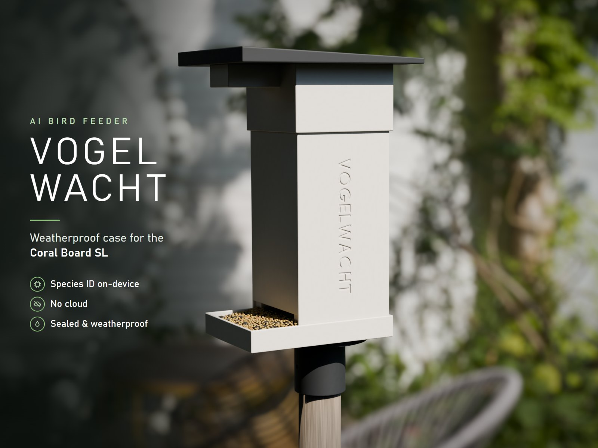

# Vogelwacht – Software for the AI Bird Feeder (version 0.1)

🇩🇪 [Deutsche Version](README.de.md)

Detects birds on the rim of the feeding tray, identifies the species and shows
every visit on a small web page – running entirely on the Synaptics Coral Board SL,
no cloud.

**Case and bird feeder:** The 3D-printable feeder with a sealed electronics bay for
the board, the parametric Fusion 360 script and the parts list are on Printables:
**[Vogelwacht – AI Bird Feeder Case for the Coral Board SL](https://www.printables.com/model/1915701-vogelwacht-ai-bird-feeder-case-for-the-coral-board)**

> **Status:** First version, **not yet tested on the board** (the board hasn't
> arrived yet). Species identification with the real model, the visit logic,
> the database and the web page are tested on a PC – see "What's tested".
>
> The web page and the bird names are in German for now.

## The web page

Daily statistics per species, visits by time of day, recent visitors with a photo
and the live image. The page follows the device's light or dark mode.

<picture>
  <source media="(prefers-color-scheme: dark)" srcset="docs/webseite_dunkel.jpg">
  
</picture>

<sub>Screenshot from the PC test with demo data, not from the board. Bird photos from
Wikimedia Commons: great tit – [Luc Viatour](https://commons.wikimedia.org/wiki/File:Parus_major_Luc_Viatour.jpg) (CC BY-SA 2.0),
blue tit – [Francis Franklin](https://commons.wikimedia.org/wiki/File:Eurasian_blue_tit_Lancashire.jpg) (CC BY-SA 3.0),
robin – [Jacob Spinks](https://commons.wikimedia.org/wiki/File:Robin_(9509442456).jpg) (CC BY 2.0),
blackbird – [Andreas Trepte](https://commons.wikimedia.org/wiki/File:Common_Blackbird.jpg) (CC BY-SA 2.5),
house sparrow – [Rhododendrites](https://commons.wikimedia.org/wiki/File:House_sparrow_male_in_Prospect_Park_(53532).jpg) (CC BY-SA 4.0),
chaffinch – [MichaelMaggs](https://commons.wikimedia.org/wiki/File:Fringilla_coelebs_(chaffinch),_male.jpg) (CC BY-SA 2.5).
The screenshots are therefore not covered by the MIT license of the code.</sub>

## How it works

```
Camera (OV5647, CSI)
  └─ Motion detection (frame difference, almost no load)
       └─ Bird detection: YOLOv8n on the Torq NPU (COCO class "bird")
            └─ Species ID: MobileNetV2 iNaturalist birds (964 species) on the CPU,
               limited to 39 common garden birds in Germany
                 └─ Visit: averaged over several frames, ends after 30 s without a bird
                      └─ SQLite + best photo (microSD) → web page, optional webhook
```

| File | Purpose |
|------|---------|
| `vogelwacht.py` | Main program (camera, pipeline, test mode) |
| `detector.py` | Bird detection on the NPU, uses code from the Synaptics examples |
| `classifier.py` | Species identification with LiteRT |
| `visits.py` | Groups detections into visits (pure logic, with tests) |
| `storage.py` | SQLite database and photos |
| `web.py` | Web page: daily statistics, recent visitors, live image |
| `species_de.py` | German bird names = list of allowed species |
| `config.toml` | All settings |
| `setup_models.sh` | Downloads the bird species model from Google Coral |
| `vogelwacht.service` | Autostart via systemd |

## Setup on the board

### 1. System

- Flash the **OOBE image** for `sl2619_coralboard` (Astra SDK **v2.6.1** or newer)
  to the SD card, e.g. with Balena Etcher:
  <https://github.com/synaptics-astra/sdk/releases>
- Set up Wi-Fi (AP12611_M2 plugged in, antenna connected):
  <https://synaptics-astra.github.io/doc/v/latest/linux/index.html#setting-up-wifi-with-wpa-supplicant>
- Access via `adb shell` (USB-C) or `ssh root@<board-ip>`.

### 2. Synaptics examples (provide the NPU runtime, the YOLO model and the camera code)

```sh
cd /home/root
git clone --recurse-submodules https://github.com/synaptics-astra-demos/sl2610-examples
cd sl2610-examples
python3 -m venv .venv --system-site-packages
. .venv/bin/activate
pip install -r requirements.txt
cd object_detection
pip install -r requirements.txt
python setup_demo.py          # downloads YOLOv8n for the NPU
```

**Check the camera** (important – this shows whether the camera module is detected):

```sh
v4l2-ctl --list-devices
python3 run_cli.py --camera-device /dev/video0 --camera-control-device /dev/v4l-subdev2 --json-results test.json
```

Hold a bird (or a bird photo) in front of the camera and `bird` should appear.

### 3. Vogelwacht

On the board (in the venv from step 2):

```sh
cd /home/root
git clone https://github.com/themarv1/vogelwacht
cd vogelwacht
. /home/root/sl2610-examples/.venv/bin/activate
pip install -r requirements.txt
sh setup_models.sh             # downloads the species model to models/
python3 tests/test_visits.py   # check the visit logic
```

**Test with a photo** (shows detection, species and timing, and saves
`<photo>_ergebnis.jpg` with boxes):

```sh
python3 vogelwacht.py --test-image /path/to/bird.jpg
```

**Continuous operation:**

```sh
python3 vogelwacht.py
```

Web page: `http://<board-ip>:8080`

### 4. Autostart

```sh
cp vogelwacht.service /etc/systemd/system/
systemctl daemon-reload
systemctl enable --now vogelwacht
journalctl -u vogelwacht -f     # follow the log
```

## Settings (`config.toml`)

The most important ones:

| Setting | Meaning |
|---------|---------|
| `camera.rotate` | Rotate the image if the camera is mounted differently |
| `camera.retune_exposure_min` | Re-adjust exposure to the daylight at this interval |
| `detector.min_score` | Score from which something counts as a bird |
| `classifier.restrict_to_garden_birds` | Only allow species from `species_de.py` (recommended) |
| `visits.gap_s` | Pause after which a new visit starts |
| `visits.min_confidence` | Below this, the visit is stored as "unbekannt" (unknown) |
| `motion.*` | Motion detection, so the AI doesn't run all the time |
| `schedule.active_from/until` | Night pause |
| `notify.webhook_url` | Report visits to Home Assistant, ntfy or similar |

To allow more species, add an entry to `species_de.py` (Latin name as in
`models/inat_bird_labels.txt`).

## What's tested

| Part | Status |
|------|--------|
| Species ID with the real model (PC, LiteRT) | ✅ great tit 98 %, blue tit 97 %, robin 100 %, blackbird 100 %, house sparrow 100 % (Wikipedia photos, side view) |
| Visit logic | ✅ 5 unit tests |
| Database, photos, web page, motion detection | ✅ test run on a PC |
| Bird detection on the NPU | ⚠️ untested – uses the code from the Synaptics examples unchanged |
| Camera, exposure | ⚠️ untested – depends on the camera module |
| Continuous operation, heat, Wi-Fi | ⚠️ untested |

## Known open points

- **View from above:** Both models were trained mostly on side views. Straight
  from above, accuracy is probably lower. Workarounds: tilt the camera slightly,
  adjust the thresholds in `config.toml`, and later fine-tune with your own photos.
- **Species model on the NPU:** It runs on the CPU for now (estimated 0.1–0.3 s
  per crop on the board). For the NPU it would have to be compiled with the Torq
  compiler (Linux PC). The model is uint8-quantized while the Torq docs mention
  int8 – whether it works directly is still open.
- **Camera class:** The camera is opened through `app_utils.camera` from the
  Synaptics examples (including auto exposure). If that causes problems with your
  camera module, set `camera.control_device`/`controls`, or temporarily rename
  `app_utils` – the camera is then opened directly with OpenCV.

## Sources

- Synaptics examples: <https://github.com/synaptics-astra-demos/sl2610-examples>
- YOLOv8n for the Torq NPU: <https://huggingface.co/Synaptics>
- Bird species model (Google Coral, iNaturalist): <https://github.com/google-coral/test_data>
- Torq compiler: <https://synaptics-torq.github.io/torq-compiler/v/latest/>

## License

The code is licensed under the [MIT License](LICENSE). The models are not part of
the repository: `setup_models.sh` downloads the species model from Google Coral,
and the YOLO model comes with the Synaptics examples. Their own licenses apply.
The screenshots in `docs/` contain photos from Wikimedia Commons under CC BY /
CC BY-SA (credits under "The web page").
