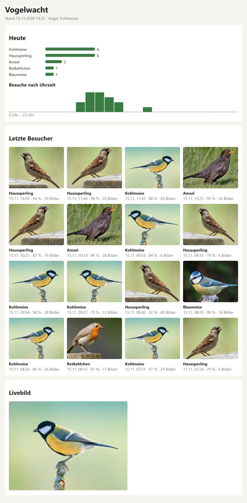

# Vogelwacht – Software für das Vogelhaus (Version 0.1)

Erkennt Vögel am Rand der Futterschale, bestimmt die Art und zeigt die Besuche auf
einer kleinen Webseite – komplett auf dem Coralboard SL, ohne Cloud.

*English: On-device bird species recognition for the Synaptics Coral Board SL.
A camera watches the feeding tray of a 3D-printed bird feeder, the board detects birds
on its NPU, identifies the species and logs each visit with a photo on a small
local web page. No cloud. Documentation below is in German.*

**Gehäuse und Futterhaus:** Das 3D-druckbare Vogelhaus mit Technikfach für das
Board, das parametrische Fusion-360-Skript und die Teileliste gibt es auf
Printables: **[Vogelwacht – AI Bird Feeder Case for the Coral Board SL](https://www.printables.com/model/1915701-vogelwacht-ai-bird-feeder-case-for-the-coral-board)**

> **Stand:** Erste Version, **noch nicht auf dem Board getestet** (Board ist
> noch nicht da). Getestet sind die Artbestimmung mit dem echten Modell,
> Besuchslogik, Datenbank und Webseite am PC – siehe „Was getestet ist“.

## Die Webseite

Tagesstatistik je Art, Besuche nach Uhrzeit, die letzten Besucher mit Foto und
das Livebild. Die Seite passt sich dem hellen bzw. dunklen Modus des Geräts an.

<picture>
  <source media="(prefers-color-scheme: dark)" srcset="docs/webseite_dunkel.jpg">
  
</picture>

<sub>Screenshot vom Test am PC mit Beispieldaten, nicht vom Board. Vogelfotos von
Wikimedia Commons: Kohlmeise – [Luc Viatour](https://commons.wikimedia.org/wiki/File:Parus_major_Luc_Viatour.jpg) (CC BY-SA 2.0),
Blaumeise – [Francis Franklin](https://commons.wikimedia.org/wiki/File:Eurasian_blue_tit_Lancashire.jpg) (CC BY-SA 3.0),
Rotkehlchen – [Jacob Spinks](https://commons.wikimedia.org/wiki/File:Robin_(9509442456).jpg) (CC BY 2.0),
Amsel – [Andreas Trepte](https://commons.wikimedia.org/wiki/File:Common_Blackbird.jpg) (CC BY-SA 2.5),
Haussperling – [Rhododendrites](https://commons.wikimedia.org/wiki/File:House_sparrow_male_in_Prospect_Park_(53532).jpg) (CC BY-SA 4.0),
Buchfink – [MichaelMaggs](https://commons.wikimedia.org/wiki/File:Fringilla_coelebs_(chaffinch),_male.jpg) (CC BY-SA 2.5).
Die Screenshots fallen deshalb nicht unter die MIT-Lizenz des Codes.</sub>

## Ablauf

```
Kamera (OV5647, CSI)
  └─ Bewegungserkennung (Bildvergleich, kaum Rechenlast)
       └─ Vogelerkennung: YOLOv8n auf der Torq-NPU (COCO-Klasse „bird“)
            └─ Artbestimmung: MobileNetV2 iNaturalist-Vögel (964 Arten) auf der CPU,
               beschränkt auf ~35 Gartenvögel in Deutschland
                 └─ Besuch: über mehrere Bilder gemittelt, endet nach 30 s ohne Vogel
                      └─ SQLite + bestes Foto (microSD) → Webseite, optional Webhook
```

| Datei | Inhalt |
|-------|--------|
| `vogelwacht.py` | Hauptprogramm (Kamera, Ablauf, Testmodus) |
| `detector.py` | Vogelerkennung auf der NPU, nutzt Code aus den Synaptics-Beispielen |
| `classifier.py` | Artbestimmung mit LiteRT |
| `visits.py` | Besuche zusammenfassen (reine Logik, mit Tests) |
| `storage.py` | SQLite-Datenbank und Fotos |
| `web.py` | Webseite: Tagesstatistik, letzte Besucher, Livebild |
| `species_de.py` | Deutsche Vogelnamen = Liste der erlaubten Arten |
| `config.toml` | Alle Einstellungen |
| `setup_models.sh` | Lädt das Vogelarten-Modell von Google Coral |
| `vogelwacht.service` | Autostart per systemd |

## Einrichtung auf dem Board

### 1. System

- SD-Karte mit dem **OOBE-Image** für `sl2619_coralboard` flashen (Astra SDK
  **v2.6.1** oder neuer), z. B. mit Balena Etcher:
  <https://github.com/synaptics-astra/sdk/releases>
- WLAN einrichten (AP12611_M2 eingesteckt, Antenne angeschlossen):
  <https://synaptics-astra.github.io/doc/v/latest/linux/index.html#setting-up-wifi-with-wpa-supplicant>
- Zugang per `adb shell` (USB-C) oder `ssh root@<board-ip>`.

### 2. Synaptics-Beispiele (liefern NPU-Laufzeit, YOLO-Modell und Kamera-Code)

```sh
cd /home/root
git clone --recurse-submodules https://github.com/synaptics-astra-demos/sl2610-examples
cd sl2610-examples
python3 -m venv .venv --system-site-packages
. .venv/bin/activate
pip install -r requirements.txt
cd object_detection
pip install -r requirements.txt
python setup_demo.py          # lädt YOLOv8n für die NPU
```

**Kamera prüfen** (wichtig – hier zeigt sich, ob die Freenove-Kamera erkannt wird):

```sh
v4l2-ctl --list-devices
python3 run_cli.py --camera-device /dev/video0 --camera-control-device /dev/v4l-subdev2 --json-results test.json
```

Hält man einen Vogel (oder ein Vogelfoto) vor die Kamera, sollte `bird`
erscheinen.

### 3. Vogelwacht

Auf dem Board (im venv von Schritt 2):

```sh
cd /home/root
git clone https://github.com/themarv1/vogelwacht
cd vogelwacht
. /home/root/sl2610-examples/.venv/bin/activate
pip install -r requirements.txt
sh setup_models.sh             # lädt das Vogelarten-Modell nach models/
python3 tests/test_visits.py   # Besuchslogik prüfen
```

**Test mit einem Foto** (zeigt Erkennung, Art und Rechenzeit, speichert
`<foto>_ergebnis.jpg` mit Rahmen):

```sh
python3 vogelwacht.py --test-image /pfad/zu/vogel.jpg
```

**Dauerbetrieb:**

```sh
python3 vogelwacht.py
```

Webseite: `http://<board-ip>:8080`

### 4. Autostart

```sh
cp vogelwacht.service /etc/systemd/system/
systemctl daemon-reload
systemctl enable --now vogelwacht
journalctl -u vogelwacht -f     # Ausgaben ansehen
```

## Einstellungen (`config.toml`)

Die wichtigsten:

| Einstellung | Bedeutung |
|-------------|-----------|
| `camera.rotate` | Bild drehen, falls die Kamera anders eingebaut ist |
| `camera.retune_exposure_min` | Belichtung regelmäßig an das Tageslicht anpassen |
| `detector.min_score` | ab wann etwas als Vogel gilt |
| `classifier.restrict_to_garden_birds` | nur Arten aus `species_de.py` zulassen (empfohlen) |
| `visits.gap_s` | Pause, nach der ein neuer Besuch beginnt |
| `visits.min_confidence` | darunter wird „unbekannt“ gespeichert |
| `motion.*` | Bewegungserkennung, damit die KI nicht dauernd läuft |
| `schedule.active_from/until` | Nachtpause |
| `notify.webhook_url` | Besuch an Home Assistant, ntfy o. ä. melden |

Weitere Arten zulassen: Eintrag in `species_de.py` ergänzen (lateinischer Name
wie in `models/inat_bird_labels.txt`).

## Was getestet ist

| Teil | Status |
|------|--------|
| Artbestimmung mit dem echten Modell (PC, LiteRT) | ✅ Kohlmeise 98 %, Blaumeise 97 %, Rotkehlchen 100 %, Amsel 100 %, Haussperling 100 % (Wikipedia-Fotos, Seitenansicht) |
| Besuchslogik | ✅ 5 Unit-Tests |
| Datenbank, Fotos, Webseite, Bewegungserkennung | ✅ Testlauf am PC |
| Vogelerkennung auf der NPU | ⚠️ ungetestet – nutzt den Code aus den Synaptics-Beispielen unverändert |
| Kamera (Freenove), Belichtung | ⚠️ ungetestet – hängt vom Kameramodul ab |
| Dauerbetrieb, Wärme, WLAN | ⚠️ ungetestet |

## Bekannte offene Punkte

- **Blick von oben:** Beide Modelle wurden überwiegend mit Seitenansichten
  trainiert. Senkrecht von oben ist die Trefferquote vermutlich schlechter.
  Abhilfe: Kamera leicht schräg stellen, Schwellen in `config.toml` anpassen,
  später mit eigenen Fotos nachtrainieren.
- **Artmodell auf der NPU:** Läuft vorerst auf der CPU (geschätzt 0,1–0,3 s
  pro Ausschnitt auf dem Board). Für die NPU müsste es mit dem Torq-Compiler
  übersetzt werden (Linux-PC); das Modell ist uint8-quantisiert, die
  Torq-Doku nennt int8 – ob das direkt geht, ist offen.
- **Kamera-Klasse:** Die Kamera wird über `app_utils.camera` aus den
  Synaptics-Beispielen geöffnet (inkl. Belichtungsautomatik). Falls das mit
  dem Freenove-Modul Probleme macht: `camera.control_device`/`controls`
  setzen oder `app_utils` testweise umbenennen, dann wird die Kamera direkt
  per OpenCV geöffnet.

## Quellen

- Synaptics-Beispiele: <https://github.com/synaptics-astra-demos/sl2610-examples>
- YOLOv8n für die Torq-NPU: <https://huggingface.co/Synaptics>
- Vogelarten-Modell (Google Coral, iNaturalist): <https://github.com/google-coral/test_data>
- Torq-Compiler: <https://synaptics-torq.github.io/torq-compiler/v/latest/>

## Lizenz

Der Code steht unter der [MIT-Lizenz](LICENSE). Die Modelle gehören nicht zum
Repository: Das Vogelarten-Modell lädt `setup_models.sh` von Google Coral, das
YOLO-Modell kommt über die Synaptics-Beispiele. Für sie gelten die Lizenzen der
jeweiligen Quelle. Die Screenshots in `docs/` enthalten Fotos von Wikimedia
Commons unter CC BY / CC BY-SA (Urheber siehe „Die Webseite“).
